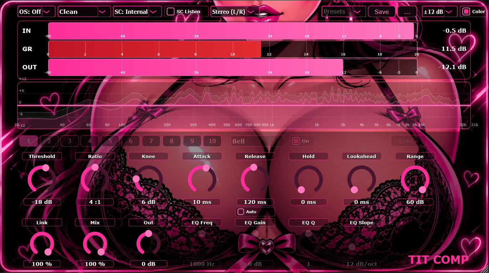

# TIT COMP

**Free compressor plugin (VST3 for Windows and macOS, AU for macOS)** with nine selectable behaviours, a 10-band sidechain EQ, oversampling up to 8x and a **Color** switch for saturation and tone. No registration, no ads, no limits.

Each mode copies the *dynamic behaviour* (static curve, attack, release, memory) of a type of reference compressor. Every number was fitted to measurements made on real plugins, using test signals. Nothing is copied from anyone's code, graphics or sound files.

## Modes
| Mode | Character |
|---|---|
| **Clean** | Transparent digital compressor, every control free. |
| **VCA TIT** | Fast, punchy bus-style VCA compressor. Attack, release (with Auto), ratio 2/4/10, make-up. |
| **FET TIT / FET TIT B** | Very fast FET-style compressors. Input, Output, Attack 1–7, Release 1–7, ratio 4/8/12/20. |
| **OP TIT** | Optical compressor with a two-stage release. Peak Reduction and Gain. |
| **FAIR TIT** | Variable-mu compressor. Input Gain, Threshold, Time Constant 1–6, Output, Mix. |
| **TIT MU** | Mu-style compressor with its own sidechain filter, attack and recovery steps. |
| **DXX TIT** | RMS VCA compressor with level-dependent attack. |
| **TIT DIGITAL** | Digital compressor with an adjustable (up to infinite) knee. |

Selecting a mode loads its starting values and shows only the controls that mode really has.

## Features
- Threshold, ratio, knee, attack, release, hold, lookahead (up to 20 ms), range, stereo link, mix and output.
- Internal or external sidechain with a **10-band EQ** (bell, shelves, cuts, tilt). Click the graph to add a band, double-click to switch it on or off, right-click to delete it. **SC Listen** lets you hear the filtered sidechain.
- Oversampling Off / 2x / 4x / 8x. The plugin reports its latency to the host.
- Input / gain reduction / output meters.
- **Color** (on by default): the saturation and tone measured for FAIR, FET, FET B, OP and DXX. VCA, MU and DIGITAL have none.
- Presets, with save/load to any folder.

## Start-up settings
The Color button starts **on**. To change it for new instances use the menu `...` → "Color on at start", or edit `config.txt`:

    color = off

Location: Windows `%APPDATA%\TIT Audio\TIT COMP\`, macOS `~/Library/Application Support/TIT Audio/TIT COMP/`. Existing projects keep their saved state.

## Install
Download the latest build from the repository's *Actions* → artifact `TITCOMP-all`, copy `TIT COMP.vst3` to your VST3 folder (Windows: `C:\Program Files\Common Files\VST3`, macOS: `/Library/Audio/Plug-Ins/VST3`) and rescan in your DAW.
Unsigned macOS builds: `xattr -cr "TIT COMP.vst3"` (or `.component`).

## Build from source
`cmake -B build && cmake --build build --config Release`. Needs CMake 3.22+ and a C++17 compiler; JUCE 8 is downloaded automatically. Core tests (no JUCE): `g++ -std=c++17 -O1 tests/core_test.cpp -o core_test && ./core_test`.

## License
Free software under the **GNU AGPLv3** (see `LICENSE`), built with JUCE 8. The source code is in this repository.
All trademarks belong to their owners; TIT COMP is not affiliated with or endorsed by anyone, and the modes are described only by type (VCA, FET, optical, variable-mu...).

---

## Resumen en español
TIT COMP es un compresor gratuito (VST3 y AU) con nueve modos: Clean, VCA, FET, FET B, OP (óptico), FAIR (variable-mu), MU, DXX y DIGITAL. Cada modo copia el comportamiento dinámico de un tipo de compresor, ajustado con mediciones. Incluye sidechain con EQ de 10 bandas, oversampling hasta 8x y un botón **Color** (arranca activado) para la saturación y el timbre medidos. Se puede elegir si Color arranca en on u off desde el menú `...` o en `config.txt`. Licencia AGPLv3.
